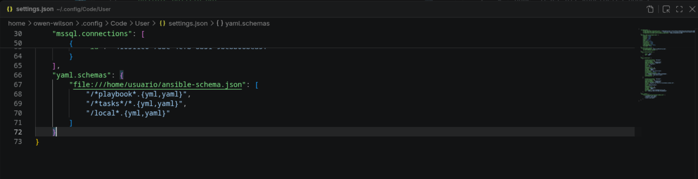

# self-hosted-ansible-lint-vscode

- this is an example ansible-lint for vscode

## vscode

- configure settings.json in vscode
- ctrl + shift + ,
- open user settings json

```sh
"yaml.schemas": {
    "file:///home/usuario/ansible-schema.json": [
        "/*playbook*.{yml,yaml}",
        "/*tasks*/*.{yml,yaml}",
        "/local*.{yml,yaml}"
    ]
}
```



```sh
mkdir -p /home/user/.ansible/ansible-lint
```

- copy [raw ansible.json](https://github.com/ansible/ansible-lint/blob/main/src/ansiblelint/schemas/ansible.json) file to local file

```sh
nano ansible-schema.json
```

## reference links

- check out [ansible lint](https://github.com/ansible/ansible-lint/)
- check out [review ansible json file](https://github.com/ansible/ansible-lint/blob/main/src/ansiblelint/schemas/ansible.json)
